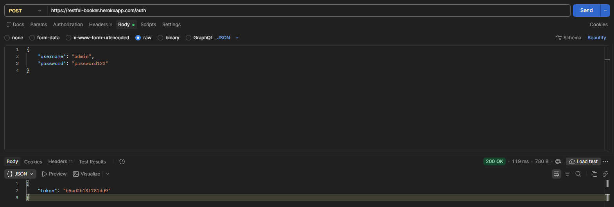
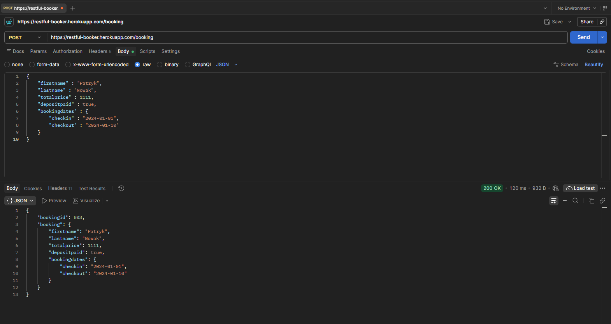
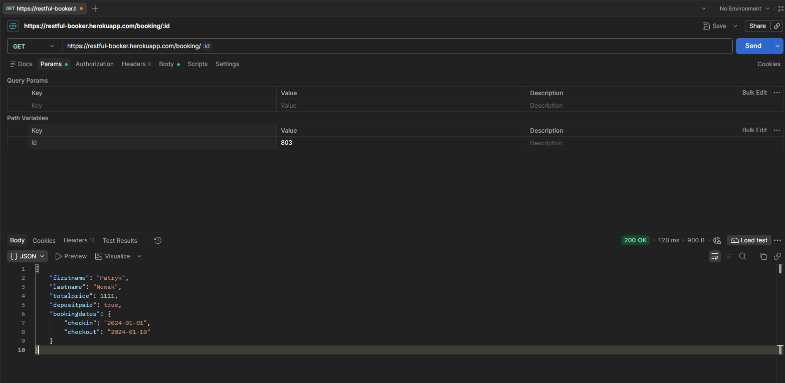
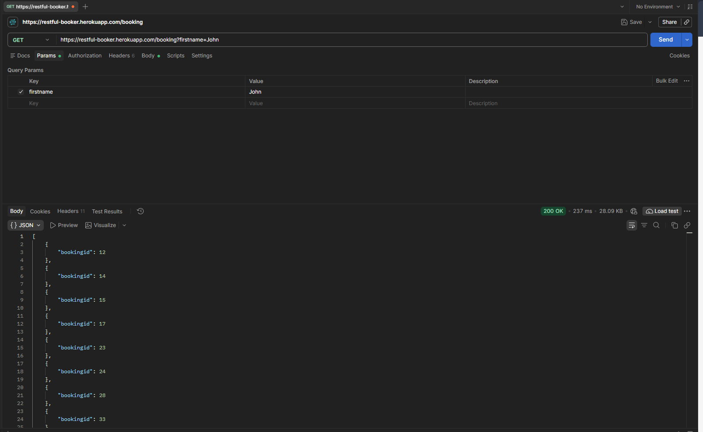
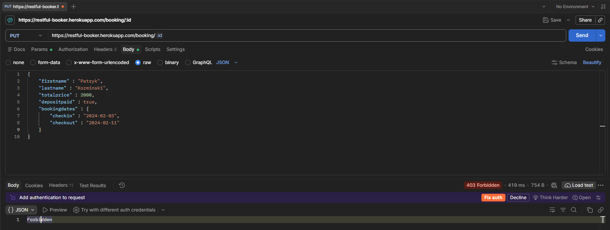
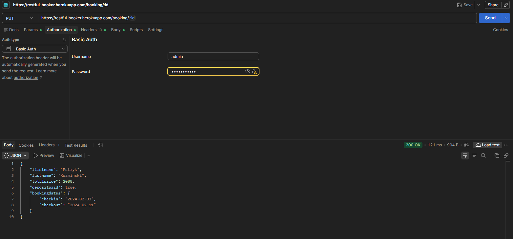
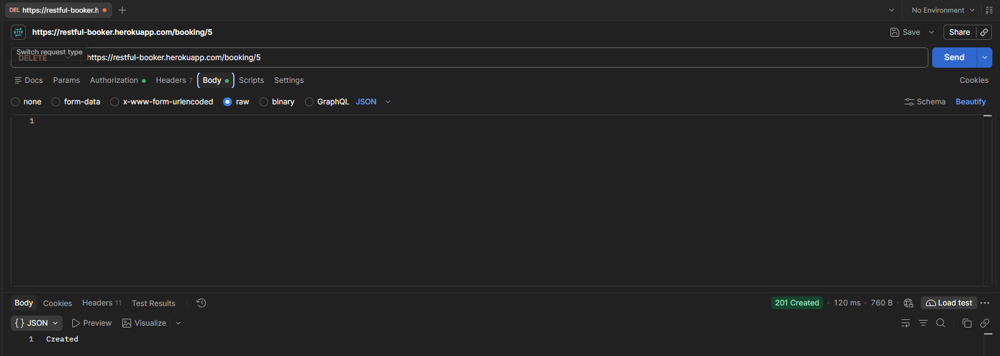
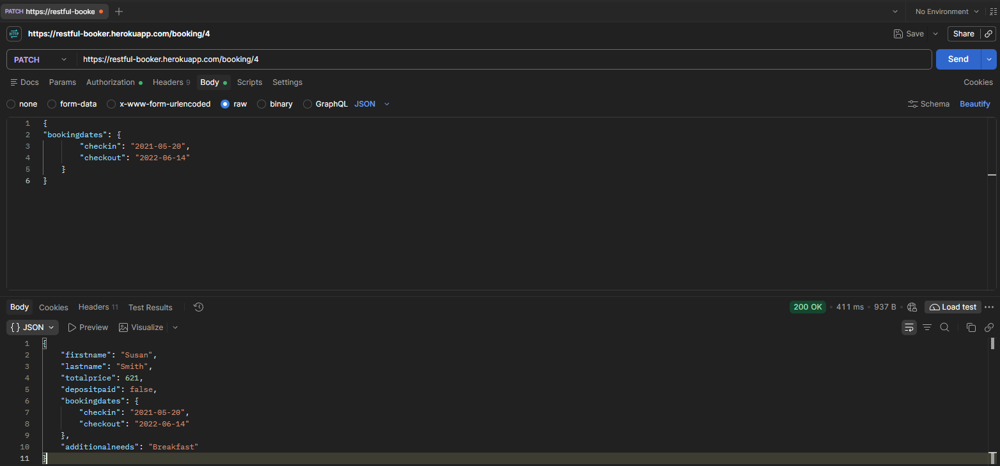

# Test cases: Restful-Booker

**API:** https://restful-booker.herokuapp.com
**Tool:** Postman
**Date:** 2026-11-07

## Summary

| ID | Method | Endpoint | Scenario | Result |
|---|---|---|---|---|
| TC-01 | POST | `/auth` | Create an auth token | PASS |
| TC-02 | POST | `/booking` | Create a booking | PASS |
| TC-03 | GET | `/booking/{id}` | Get a booking by id | PASS |
| TC-04 | GET | `/booking?firstname=John` | Filter bookings by first name | PASS |
| TC-05 | PUT | `/booking/{id}` | Update a booking without authorization | PASS |
| TC-06 | PUT | `/booking/{id}` | Update a booking with authorization | PASS |
| TC-07 | DELETE | `/booking/{id}` | Delete a booking | PASS |

---

## TC-01: Create an auth token

- **Request:** POST `/auth`
- **Body:**
  ```json
  {
    "username": "admin",
    "password": "password123"
  }
  ```
- **Expected:** status 200, response contains a `token`
- **Actual:** status 200 OK, response contains `token`
- **Result:** PASS



---

## TC-02: Create a booking

- **Request:** POST `/booking`
- **Body:**
  ```json
  {
    "firstname": "Patryk",
    "lastname": "Nowak",
    "totalprice": 1111,
    "depositpaid": true,
    "bookingdates": {
      "checkin": "2024-01-01",
      "checkout": "2024-01-10"
    }
  }
  ```
- **Expected:** booking created, response contains `bookingid` and the sent data
- **Actual:** status 200 OK, `bookingid` is 803, `booking` contains all sent fields
- **Result:** PASS (note: the API returns 200, not 201 Created)



---

## TC-03: Get a booking by id

- **Request:** GET `/booking/803`
- **Expected:** status 200, data matches the booking created in TC-02
- **Actual:** status 200 OK, `firstname` is Patryk, `lastname` is Nowak, `totalprice` is 1111, dates are 2024-01-01 to 2024-01-10
- **Result:** PASS



---

## TC-04: Filter bookings by first name

- **Request:** GET `/booking?firstname=John`
- **Expected:** status 200, response is a list of booking ids
- **Actual:** status 200 OK, list of objects with `bookingid` (12, 14, 15, 17, 23, ...)
- **Result:** PASS (only ids are returned, so the filter itself was not verified against the booking data)



---

## TC-05: Update a booking without authorization

- **Request:** PUT `/booking/803` with no token and no authorization
- **Body:**
  ```json
  {
    "firstname": "Patryk",
    "lastname": "Kozminski",
    "totalprice": 2000,
    "depositpaid": true,
    "bookingdates": {
      "checkin": "2024-02-03",
      "checkout": "2024-02-11"
    }
  }
  ```
- **Expected:** status 403 Forbidden
- **Actual:** status 403 Forbidden, body `Forbidden`
- **Result:** Forbidden



---

## TC-06: Update a booking with authorization

- **Request:** PUT `/booking/803` with Basic Auth (`admin`)
- **Body:** same as TC-05
- **Expected:** status 200, response contains the new values
- **Actual:** status 200 OK, `lastname` is Kozminski, `totalprice` is 2000, dates are 2024-02-03 to 2024-02-11
- **Result:** PASS



---

## TC-07: Delete a booking

- **Request:** DELETE `/booking/803` with authorization
- **Expected:** booking deleted, success status
- **Actual:** status 201 Created, body `Created`
- **Result:** PASS (note: DELETE returns 201 instead of the usual 200 or 204)



## TC-07: Partially update a booking

- **Request:** PATCH `/booking/4`
- **Expected:** booking updated, success status
- **Actual:** status 200 OK
- **Result:** PASS
- **FROM:** 
{
    "bookingdates": {
        "checkin": "2021-05-30",
        "checkout": "2022-06-24"
    }
}
- **TO:**
{
    "bookingdates": {
        "checkin": "2021-05-20",
        "checkout": "2022-06-14"
    },
}

---

## Notes

- Restful-Booker is a shared public service. Data is reset periodically and anyone can modify bookings, so ids and data can change between runs.
- PUT, PATCH and DELETE require a token (`Cookie: token=...`) or Basic Auth.
- Unusual status codes: POST `/booking` returns 200 and DELETE returns 201.