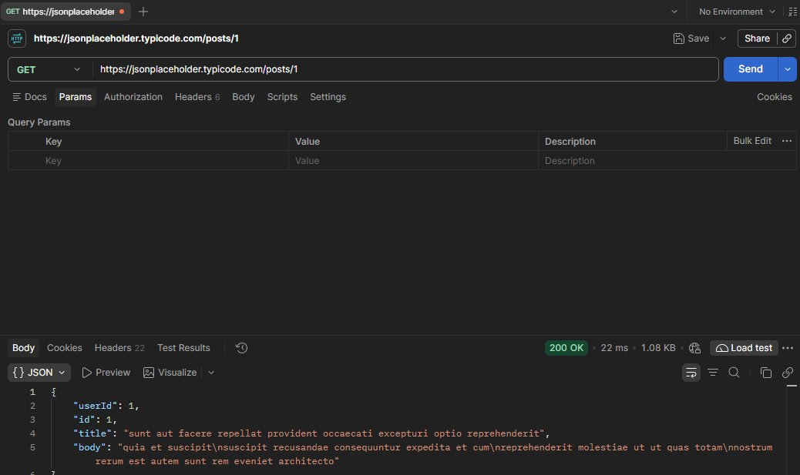
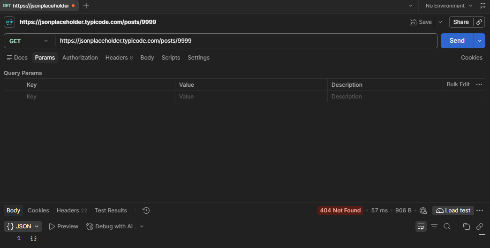
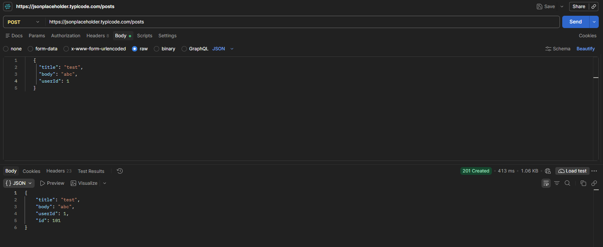
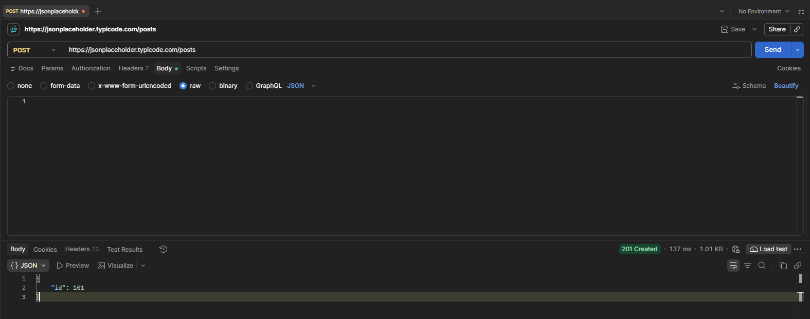
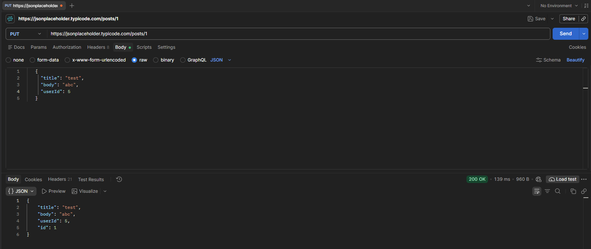
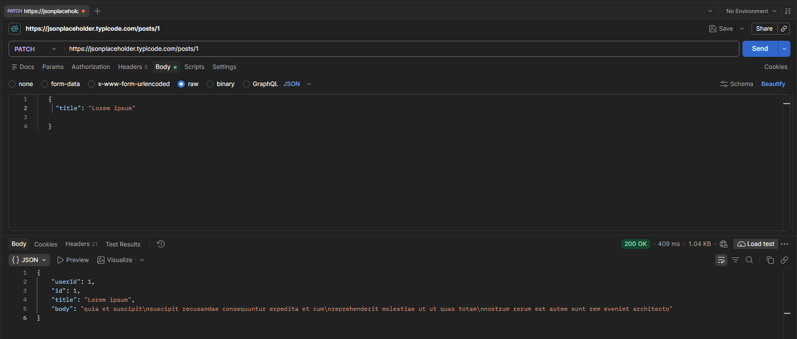
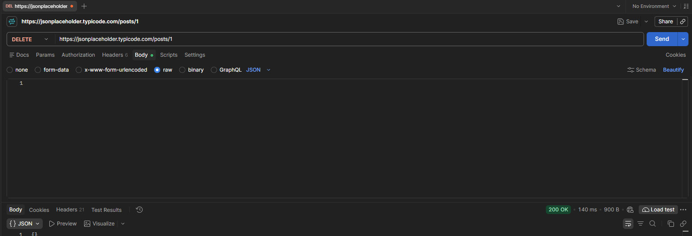

# Test cases: JSONPlaceholder

**API:** https://jsonplaceholder.typicode.com
**Tool:** Postman
**Date:** 2026-11-07

## Summary

| ID | Method | Endpoint | Scenario | Result |
|---|---|---|---|---|
| TC-01 | GET | `/posts/1` | Get an existing post | PASS |
| TC-02 | GET | `/posts/9999` | Get a non-existent post | PASS |
| TC-03 | POST | `/posts` | Create a post | PASS |
| TC-04 | POST | `/posts` | Create a post with an empty body | FAIL |
| TC-05 | PUT | `/posts/1` | Replace a post | PASS |
| TC-06 | PATCH | `/posts/1` | Update one field of a post | PASS |
| TC-07 | DELETE | `/posts/1` | Delete a post | PASS |

---

## TC-01: Get an existing post

- **Request:** GET `/posts/1`
- **Expected:** status 200, JSON with `userId`, `id`, `title`, `body`
- **Actual:** status 200 OK, all fields present, `id` is 1
- **Result:** PASS



---

## TC-02: Get a non-existent post

- **Request:** GET `/posts/9999`
- **Expected:** status 404
- **Actual:** status 404 Not Found, empty JSON `{}`
- **Result:** PASS



---

## TC-03: Create a post

- **Request:** POST `/posts`
- **Body:**
  ```json
  {
    "title": "test",
    "body": "abc",
    "userId": 1
  }
  ```
- **Expected:** status 201, response contains the sent data and a new `id`
- **Actual:** status 201 Created, response contains `title`, `body`, `userId` and `id` 101
- **Result:** PASS



---

## TC-04: Create a post with an empty body

- **Request:** POST `/posts`
- **Body:** empty
- **Expected:** request rejected with a client error (e.g. 400)
- **Actual:** status 201 Created, response contains only `{"id": 101}`
- **Result:** FAIL (the API does not validate input)



---

## TC-05: Replace a post

- **Request:** PUT `/posts/1`
- **Body:**
  ```json
  {
    "title": "test",
    "body": "abc",
    "userId": 5
  }
  ```
- **Expected:** status 200, response contains the new values and `id` 1
- **Actual:** status 200 OK, `title` is "test", `body` is "abc", `userId` is 5, `id` is 1
- **Result:** PASS



---

## TC-06: Update one field of a post

- **Request:** PATCH `/posts/1`
- **Body:**
  ```json
  {
    "title": "Lorem ipsum"
  }
  ```
- **Expected:** status 200, `title` changed, other fields unchanged
- **Actual:** status 200 OK, `title` is "Lorem ipsum", `userId`, `id` and `body` keep their original values
- **Result:** PASS



---

## TC-07: Delete a post

- **Request:** DELETE `/posts/1`
- **Expected:** status 200, empty JSON
- **Actual:** status 200 OK, empty JSON `{}`
- **Result:** PASS



---

## Notes

- JSONPlaceholder only simulates writes. POST, PUT, PATCH and DELETE return realistic responses, but nothing is saved, so a later GET returns the original data.
- The API accepts an empty body on POST (TC-04). A real API should reject it.